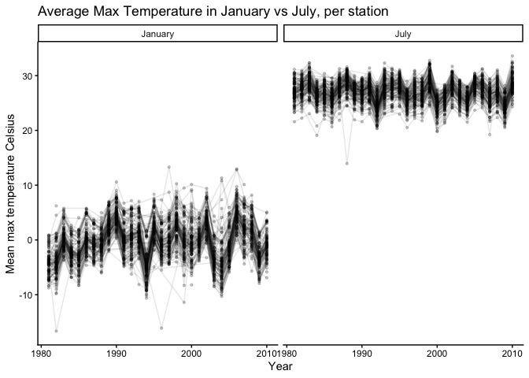
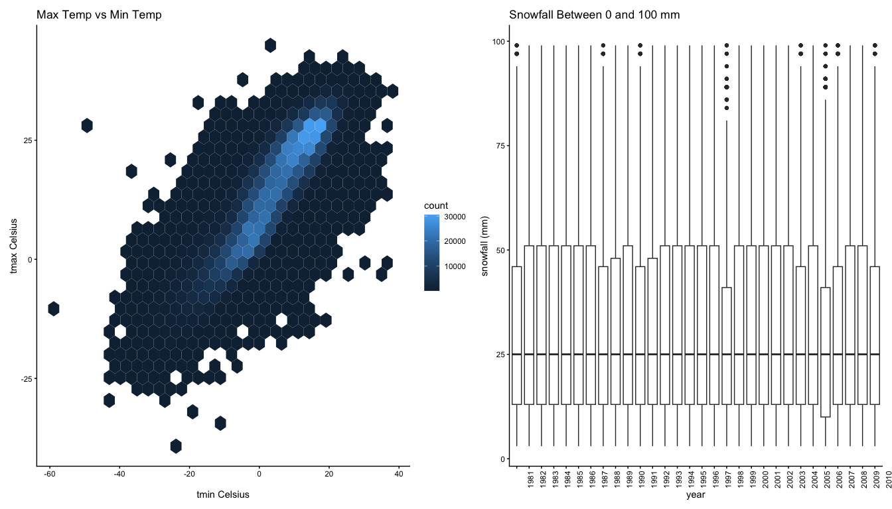
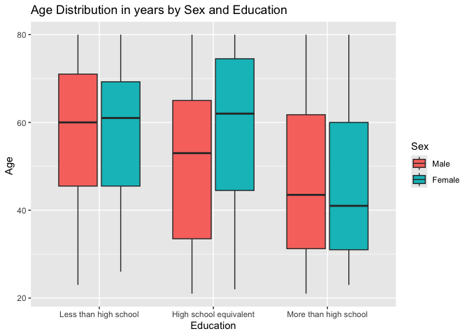
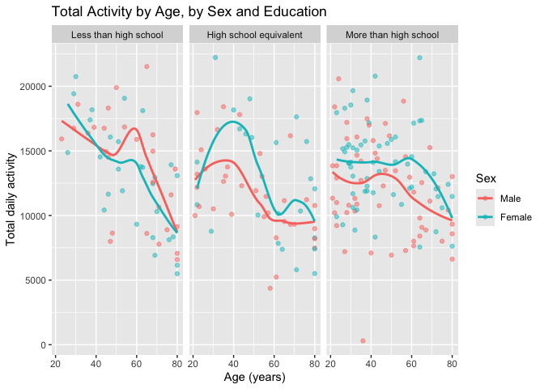
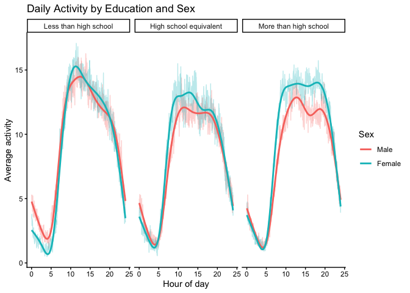
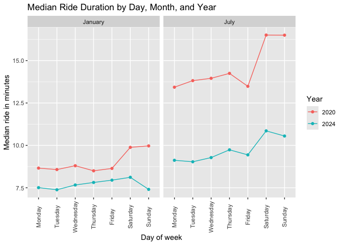
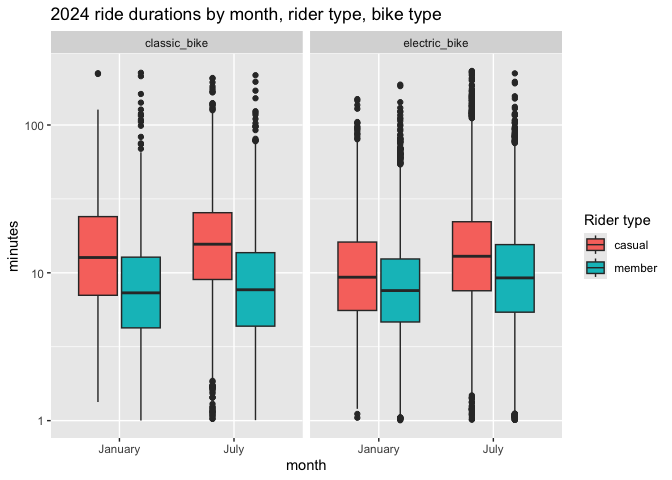

HW3
================
2026-10-14

``` r
library(tidyverse)
```

    ## ── Attaching core tidyverse packages ──────────────────────── tidyverse 2.0.0 ──
    ## ✔ dplyr     1.2.1     ✔ readr     2.2.0
    ## ✔ forcats   1.0.1     ✔ stringr   1.6.0
    ## ✔ ggplot2   4.0.3     ✔ tibble    3.3.1
    ## ✔ lubridate 1.9.5     ✔ tidyr     1.3.2
    ## ✔ purrr     1.2.2     
    ## ── Conflicts ────────────────────────────────────────── tidyverse_conflicts() ──
    ## ✖ dplyr::filter() masks stats::filter()
    ## ✖ dplyr::lag()    masks stats::lag()
    ## ℹ Use the conflicted package (<http://conflicted.r-lib.org/>) to force all conflicts to become errors

``` r
library(lubridate)
library(patchwork)
library(hexbin)
```

## Question 1

``` r
library(p8105.datasets)
data("ny_noaa")
summary(ny_noaa)
```

    ##          id               date                 prcp         
    ##  Length   :2595176   Min.   :1981-01-01   Min.   :    0.00  
    ##  N.unique :    747   1st Qu.:1988-11-29   1st Qu.:    0.00  
    ##  N.blank  :      0   Median :1997-01-21   Median :    0.00  
    ##  Min.nchar:     11   Mean   :1997-01-01   Mean   :   29.82  
    ##  Max.nchar:     11   3rd Qu.:2005-09-01   3rd Qu.:   23.00  
    ##                      Max.   :2010-12-31   Max.   :22860.00  
    ##                                           NAs    :145838    
    ##       snow                snwd                tmax                tmin        
    ##  Min.   :  -13.000   Min.   :   0.00   Length   :2595176   Length   :2595176  
    ##  1st Qu.:    0.000   1st Qu.:   0.00   N.unique :    532   N.unique :    548  
    ##  Median :    0.000   Median :   0.00   N.blank  :      0   N.blank  :      0  
    ##  Mean   :    4.987   Mean   :  37.31   Min.nchar:      1   Min.nchar:      1  
    ##  3rd Qu.:    0.000   3rd Qu.:   0.00   Max.nchar:      4   Max.nchar:      4  
    ##  Max.   :10160.000   Max.   :9195.00   NAs      :1134358   NAs      :1134420  
    ##  NAs    :381221      NAs    :591786

This data set has 2595176 rows and 7 columns. Key variables include, id,
date, prcp, snow, snwd, tmax, and tmin. There are quite a lot of NA
values, especially in the tmax and tmin variables.

``` r
# Data Cleaning and Converting Units
ny_noaa <- 
  ny_noaa |> 
  drop_na() |>
  mutate(
    year = year(date),
    month = month(date),
    day = day(date),
    tmax = as.numeric(tmax) / 10,
    tmin = as.numeric(tmin) / 10, 
    prcp = prcp / 10
  )
summary(ny_noaa)
```

    ##          id               date                 prcp               snow         
    ##  Length   :1222433   Min.   :1981-01-01   Min.   :   0.000   Min.   : -13.000  
    ##  N.unique :    214   1st Qu.:1988-01-27   1st Qu.:   0.000   1st Qu.:   0.000  
    ##  N.blank  :      0   Median :1994-09-28   Median :   0.000   Median :   0.000  
    ##  Min.nchar:     11   Mean   :1995-05-06   Mean   :   3.008   Mean   :   4.649  
    ##  Max.nchar:     11   3rd Qu.:2002-08-14   3rd Qu.:   2.300   3rd Qu.:   0.000  
    ##                      Max.   :2010-12-31   Max.   :2032.500   Max.   :7765.000  
    ##       snwd              tmax             tmin              year     
    ##  Min.   :   0.00   Min.   :-38.90   Min.   :-58.300   Min.   :1981  
    ##  1st Qu.:   0.00   1st Qu.:  5.60   1st Qu.: -2.800   1st Qu.:1988  
    ##  Median :   0.00   Median : 16.10   Median :  4.400   Median :1994  
    ##  Mean   :  36.66   Mean   : 14.65   Mean   :  3.625   Mean   :1995  
    ##  3rd Qu.:   0.00   3rd Qu.: 23.90   3rd Qu.: 11.700   3rd Qu.:2002  
    ##  Max.   :9195.00   Max.   : 44.40   Max.   : 37.200   Max.   :2010  
    ##      month             day       
    ##  Min.   : 1.000   Min.   : 1.00  
    ##  1st Qu.: 4.000   1st Qu.: 8.00  
    ##  Median : 7.000   Median :16.00  
    ##  Mean   : 6.596   Mean   :15.71  
    ##  3rd Qu.: 9.000   3rd Qu.:23.00  
    ##  Max.   :12.000   Max.   :31.00

``` r
# prcp: Precipitation (tenths of mm)
# snow: Snowfall (mm)
# temp: (tenths of degrees C)
```

``` r
ny_noaa |> 
  count(snow, sort = T)
```

    ## # A tibble: 248 × 2
    ##     snow       n
    ##    <int>   <int>
    ##  1     0 1112758
    ##  2    25   15809
    ##  3    13   12460
    ##  4    51    9252
    ##  5     5    5669
    ##  6     8    5380
    ##  7    76    5296
    ##  8     3    5276
    ##  9    38    5050
    ## 10   102    3386
    ## # ℹ 238 more rows

For snowfall, the most commonly observed value is 0, because it doesn’t
snow most days of the year.

``` r
ny_noaa |> 
  filter(month == 1 | month == 7) |>      # Jan or July only
  group_by(id, year, month) |>      # per each station and year
  summarize(mean_tmax = mean(tmax, na.rm = T), .groups = "drop") |>     # dropping NA to remove clutter
  drop_na(mean_tmax) |> 
  mutate(month = factor(month, levels = c(1, 7), labels = c("January", "July"))) |> 
  ggplot(aes(x = year, y = mean_tmax, group = id)) +
  geom_point(alpha = 0.2, size = 0.8) +
  geom_line(alpha = 0.1) +
  facet_grid(. ~ month) +
  labs(x = "Year", 
       y = "Mean max temperature Celsius",
       title = "Average Max Temperature in January vs July, per station")+
  theme_classic()
```

<!-- --> From
these plots, we can see that the average max temperature in January is
much lower compared to July. In January, the range is from about 10°C to
below -10°C. In July it is as hot as over 30°C to about 20°C, with an
outlier of ~14°C.

``` r
# tmax vs tmin
p1 <- ny_noaa |> 
  drop_na(tmax, tmin) |> 
  ggplot(aes(x = tmin, y = tmax)) +
  geom_hex() +
  labs(x = "tmin Celsius", 
       y = "tmax Celsius", 
       title = "Max Temp vs Min Temp") +
  theme_classic()

# snowfall 
p2 <- ny_noaa |> 
  filter(snow > 0, snow < 100) |> 
  mutate(year = factor(year)) |> 
  ggplot(aes(x = year, y = snow)) +
  geom_boxplot() +
  labs(x = "year", 
       y = "snowfall (mm)", 
       title = "Snowfall Between 0 and 100 mm") +
  theme_classic() +
  theme(axis.text.x = element_text(angle = 90, vjust = 3, hjust = 3))
  
p1 + p2
```

<!-- -->
There is a a strong positive relationship between tmax and tmin. The
cluster is dense in moderate temps of about 0 - 15 Celsius minimum, and
10 - 25 Celsius maximum. For snowfall, the shape is similar across
years, with most values being small values. A few years that stand out
however, are 1997, 2003, 2005, 2006, and 2009.

## Question 2

``` r
nhanes_accel <- read_csv("data/nhanes_accel.csv") |> 
  janitor::clean_names()
```

    ## Rows: 250 Columns: 1441
    ## ── Column specification ────────────────────────────────────────────────────────
    ## Delimiter: ","
    ## dbl (1441): SEQN, min1, min2, min3, min4, min5, min6, min7, min8, min9, min1...
    ## 
    ## ℹ Use `spec()` to retrieve the full column specification for this data.
    ## ℹ Specify the column types or set `show_col_types = FALSE` to quiet this message.

``` r
nhanes_covar <- read_csv("data/nhanes_covar.csv", skip = 4) |> 
    janitor::clean_names()
```

    ## Rows: 250 Columns: 5
    ## ── Column specification ────────────────────────────────────────────────────────
    ## Delimiter: ","
    ## dbl (5): SEQN, sex, age, BMI, education
    ## 
    ## ℹ Use `spec()` to retrieve the full column specification for this data.
    ## ℹ Specify the column types or set `show_col_types = FALSE` to quiet this message.

``` r
# cleaning 
nhanes_df <- 
  nhanes_covar |> 
  drop_na() |>                       # drop people wiht missing demographic data
  filter(age >= 21) |>               # adults 
  mutate(
    sex = factor(sex, levels = c(1, 2), 
                 labels = c("Male", "Female")),
    education = factor(education, levels = c(1, 2, 3),
                       labels = c("Less than high school", 
                                  "High school equivalent", 
                                  "More than high school"))
  ) |> 
  inner_join(nhanes_accel, by = "seqn") 
```

# table of men and women by education

``` r
nhanes_df |> 
  count(education, sex) |> 
  pivot_wider(names_from = sex, values_from = n) |> 
  knitr::kable(col.names = c("Education", "Male", "Female"))
```

| Education              | Male | Female |
|:-----------------------|-----:|-------:|
| Less than high school  |   27 |     28 |
| High school equivalent |   35 |     23 |
| More than high school  |   56 |     59 |

# age distribution by sex and education

``` r
nhanes_df |> 
  ggplot(aes(x = education, y = age, fill = sex)) +
  geom_boxplot() +
  labs(x = "Education", y = "Age ", fill = "Sex",
       title = "Age Distribution in years by Sex and Education")
```

<!-- -->

# total activity by age

``` r
nhanes_df <- 
  nhanes_df |> 
  mutate(total_activity = rowSums(across(starts_with("min"))))

nhanes_df |> 
  ggplot(aes(x = age, y = total_activity, color = sex)) +
  geom_point(alpha = 0.5) +
  geom_smooth(se = F) +
  facet_grid(. ~ education) +
  labs(x = "Age (years)", y = "Total daily activity", color = "Sex",
       title = "Total Activity by Age, by Sex and Education") 
```

    ## `geom_smooth()` using method = 'loess' and formula = 'y ~ x'

<!-- --> In
the More than high school group, women are more active than men at most
ages, with the gap narrowing in later life. Across all three education
levels, total daily activity declines with age, especially around the
age of 60. In the High School Equivalent group, women are generally more
active than men as well. In the Less the High School group, the activity
is led by women, with men being more active after the age of about 40.

# 24 Hr plot

``` r
nhanes_df |> 
  pivot_longer(starts_with("min"), 
               names_to = "minute", 
               names_prefix = "min", 
               values_to = "mims") |> 
  mutate(hour = as.numeric(minute) / 60) |> 
  group_by(education, sex, hour) |> 
  summarize(mean_mims = mean(mims), .groups = "drop") |> 
  ggplot(aes(x = hour, 
             y = mean_mims, 
             color = sex)) +
  geom_line(alpha = 0.3) +
  facet_grid(. ~ education) +
  geom_smooth(se = F) +
  labs(x = "Hour of day", 
       y = "Average activity", 
       color = "Sex",
       title = "Daily Activity by Education and Sex") + 
  theme_classic()
```

    ## `geom_smooth()` using method = 'gam' and formula = 'y ~ s(x, bs = "cs")'

<!-- --> In
all three education groups, the mean activity througout the day is about
the same. Activity is lowest around 4am and riced between 5 am and 9 am.
In the High schol equivalent and more than high school groups, there is
a bit of deviation from the mal and femlale groups, with females have
higher mean activity. It is hard to tell is higher education is
associated with more daytime actifiy level, but there does seem to be
the most acitivty in the less than high school group.

## Question 3

``` r
jan_2020 = 
  read_csv("data/Jan2020Citi.csv") |> 
  janitor::clean_names() |> 
  mutate(year = "2020", month = "January")
```

    ## Rows: 12420 Columns: 7
    ## ── Column specification ────────────────────────────────────────────────────────
    ## Delimiter: ","
    ## chr (6): ride_id, rideable_type, weekdays, start_station_name, end_station_n...
    ## dbl (1): duration
    ## 
    ## ℹ Use `spec()` to retrieve the full column specification for this data.
    ## ℹ Specify the column types or set `show_col_types = FALSE` to quiet this message.

``` r
july_2020 = 
  read_csv("data/July2020Citi.csv") |> 
  janitor::clean_names() |> 
  mutate(year = "2020", month = "July")
```

    ## Rows: 21048 Columns: 7
    ## ── Column specification ────────────────────────────────────────────────────────
    ## Delimiter: ","
    ## chr (6): ride_id, rideable_type, weekdays, start_station_name, end_station_n...
    ## dbl (1): duration
    ## 
    ## ℹ Use `spec()` to retrieve the full column specification for this data.
    ## ℹ Specify the column types or set `show_col_types = FALSE` to quiet this message.

``` r
jan_2024 = 
  read_csv("data/Jan2024Citi.csv") |> 
  janitor::clean_names() |> 
  mutate(year = "2024", month = "January")
```

    ## Rows: 18861 Columns: 7
    ## ── Column specification ────────────────────────────────────────────────────────
    ## Delimiter: ","
    ## chr (6): ride_id, rideable_type, weekdays, start_station_name, end_station_n...
    ## dbl (1): duration
    ## 
    ## ℹ Use `spec()` to retrieve the full column specification for this data.
    ## ℹ Specify the column types or set `show_col_types = FALSE` to quiet this message.

``` r
july_2024 = 
  read_csv("data/July2024Citi.csv") |> 
  janitor::clean_names() |> 
  mutate(year = "2024", month = "July")
```

    ## Rows: 47156 Columns: 7
    ## ── Column specification ────────────────────────────────────────────────────────
    ## Delimiter: ","
    ## chr (6): ride_id, rideable_type, weekdays, start_station_name, end_station_n...
    ## dbl (1): duration
    ## 
    ## ℹ Use `spec()` to retrieve the full column specification for this data.
    ## ℹ Specify the column types or set `show_col_types = FALSE` to quiet this message.

``` r
citi_df = 
  bind_rows(jan_2020, july_2020, jan_2024, july_2024) |> 
  mutate(weekdays = factor(weekdays, levels = c("Monday", "Tuesday", "Wednesday", 
                                                "Thursday", "Friday", "Saturday", "Sunday")))
```

The combined dataset has 99485 rides and 9 variables, from January and
July of 2020 - 2024. The variables for each ride contain an ID, bike
type, day of the week, duration in minutes, start/end station, rider
type member/casual. For tidyness, I added a month and year variable.

# rides by month year, ride type

``` r
citi_df |> 
  count(year, 
        month, 
        member_casual) |> 
  pivot_wider(names_from = member_casual, values_from = n) |> 
  knitr::kable(col.names = c("year", " month", "casual", "member"))
```

| year | month   | casual | member |
|:-----|:--------|-------:|-------:|
| 2020 | January |    984 |  11436 |
| 2020 | July    |   5637 |  15411 |
| 2024 | January |   2108 |  16753 |
| 2024 | July    |  10894 |  36262 |

# top 5 start stations , July 2024

``` r
citi_df |> 
  filter(year == "2024", month == "July") |> 
  count(start_station_name, sort = T) |> 
  head(5) |> 
  knitr::kable(col.names = c("start station", "Num Rides"))
```

| start station            | Num Rides |
|:-------------------------|----------:|
| Pier 61 at Chelsea Piers |       163 |
| University Pl & E 14 St  |       155 |
| W 21 St & 6 Ave          |       152 |
| West St & Chambers St    |       150 |
| W 31 St & 7 Ave          |       146 |

# plot, median duration

``` r
citi_df |> 
  group_by(year, 
           month, 
           weekdays) |> 
  summarize(median_duration = median(duration), .groups = "drop") |> 
  ggplot(aes(x = weekdays, y = median_duration, color = year)) +
  geom_point() +
  geom_line(aes(group = year)) +
  facet_grid(. ~ month) +
  labs(x = "Day of week", y = "Median ride in minutes", color = "Year",
       title = "Median Ride Duration by Day, Month, and Year") +
  theme(axis.text.x = element_text(angle = 90, vjust = 0.5))
```

<!-- -->
Ride durations are much longer in July than in January, with with the
weekends have a longer ride than during the weekday. In July 2020, there
was a dip on Friday, from what we can see. These things can be due to
temperature and work schedules. Overall, 2020 ride durations are longer
than 2024.

# 2024 ride durations

``` r
citi_df |> 
  filter(year == "2024") |> 
  ggplot(aes(x = month, 
             y = duration, 
             fill = member_casual)) +
  geom_boxplot() +
  facet_grid(. ~ rideable_type) +
  scale_y_log10() +
  labs(x = "month", y = "minutes", fill = "Rider type",
       title = "2024 ride durations by month, rider type, bike type")
```

<!-- --> I
used the log scale for this plot for better readability. Casual riders
take longer rides than members across every combinition of month and
bike type. July rides are longer than January across both groups.
Classic bikes have longer rides than electric bikes, especially in
casual riders.
